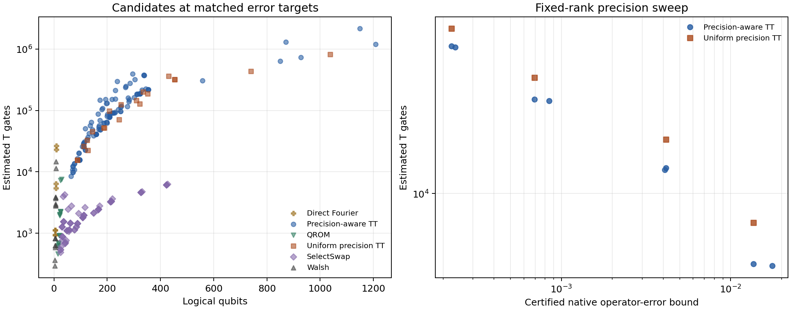

# QFlow Compiler v1

QFlow Compiler builds reversible phase oracles in Qiskit for learned potentials used in wavefunction flows. The benchmark tests whether storing a potential as a tensor train (TT) lowers the logical circuit cost once we count arithmetic, workspace and uncomputation.

The compiler uses signed fixed-point arithmetic with per-core precision and data-dependent register widths. The benchmarks compare it with uniform precision TT, QROM, SelectSwap, Walsh and, where the potential permits it, direct Fourier circuits. We checked every input address in 252 oracle circuits, for 15,600 checks in total. We also simulated small state preparation and amplitude amplification circuits.

## Results

1. **The precision-aware TT compiler reduced projected T count by 20.9% to 60.6%** relative to the uniform precision implementation. This compares the cheapest candidate in each TT family at the same error target, across eight cases and two tolerances.
2. **SelectSwap or Walsh had the lowest projected T count in all 16 comparisons.** In a separate baseline sweep, uniform precision TT used 12.7 to 53.2 times the projected T count of the cheapest alternative across four grids and two tolerances.
3. **On the 8×8 grid with 64 steps**, the precision-aware compiler reduced the TT circuit from 307 to 267 logical qubits and from 34.43 million to 29.56 million projected T gates per preparation. Walsh used 1.92 million projected T gates. The new TT circuit had an observed total variation distance of 2.41 × 10⁻⁵ and a certified native circuit bound of 0.006121, both relative to the same product formula on that grid.



The left panel pools candidates that meet the error target for their case. The right panel varies precision at fixed rank. [Oracle records](results/v03/oracles.csv) · [Preparation records](results/v03/preparation.json) · [Baseline sweep](results/oracle-study/matched.csv)

## Run the checks

Use Python 3.12. The commands below use the macOS ARM64 lockfile. On Linux x86-64, use `requirements.lock.txt`.

```bash
python3.12 -m venv .venv
source .venv/bin/activate
python -m pip install -r requirements-macos-arm64.lock.txt
python -m pip install --no-deps --no-build-isolation -e .
python -m pytest -q
python scripts/check_release_claims.py
```

Run `bash scripts/reproduce_v03.sh` in a separate checkout to regenerate the oracle and preparation results and the benchmark figure. [Reproduction guide](docs/reproduction.md)

## Methods and limits

The certificates apply to the binary64 input tables and the emitted gate angles. The preparation certificate compares circuits that use the same source and kinetic blocks. The [error analysis](docs/error_accounting.md) separates this comparison from continuum discretization, time stepping, model fit and shot noise. The [resource model](docs/resource_model.md) estimates logical Clifford+T costs. The experiments do not establish an end-to-end quantum advantage.

- [Precision analysis](docs/v03_precision.md) covers integer ranges, rounding and uncomputation.
- [Validation record](docs/release_audit.md) gives the test results, platform differences and provenance.
- [Literature and comparison methods](docs/v03_literature.md) explains the relationship to Layden et al., the Sygaldry checkpoint from Kodama et al., and Che and af Klinteberg.
- [Third-party notices](THIRD_PARTY_NOTICES.md) lists attribution and licenses.

The implementation lives in [`src/floworaclebench`](src/floworaclebench/), with [`tests`](tests/) for correctness and [`scripts`](scripts/) and [`configs`](configs/) for reproduction. [`data`](data/) contains checkpoints and saved circuits. [`results`](results/) and [`figures`](figures/) contain the recorded outputs. See the [benchmark provenance](docs/archive/README.md) for the original FlowOracleBench studies.

QFlow Compiler continues the FlowOracleBench experiments. The Python import is `floworaclebench`. AI tools assisted development and review.
